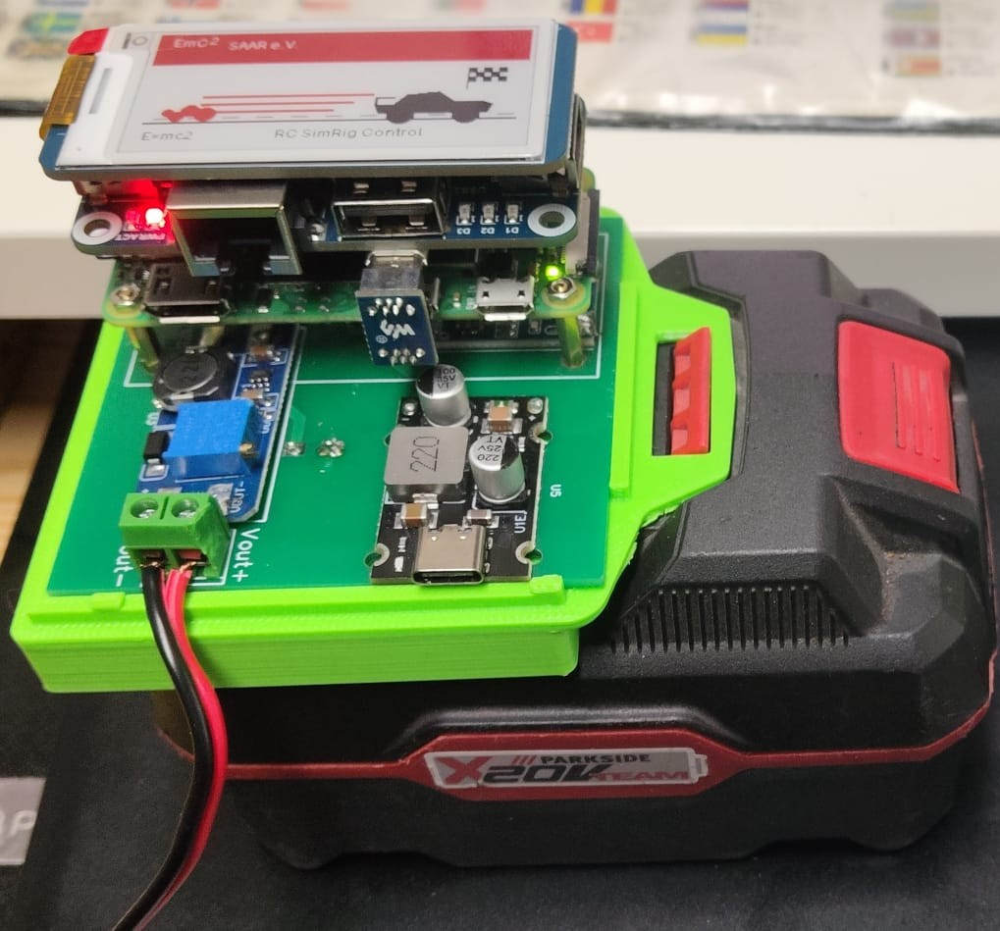

# pi2toolbattery

Mobile Stromversorgung für einen Pi Zero 2W und ein Sim-Lenkrad, direkt aus einem Werkstattakku (Parkside X20V Team).



## Wozu das Ganze?

Dieses Board entstand für ein **Sim Rig**, mit dem ein **RC-Auto** gesteuert wird (Projekt "RC SimRig Control", EmC² SAAR e.V.). Das Rig soll mobil sein, also ohne Steckdose und ohne Netzteil-Kabelsalat. Ein 20-V-Werkstattakku ist dafür ideal: Er liefert viel Leistung, ist günstig, schnell getauscht und meist schon vorhanden.

Das PCB sitzt direkt auf dem Akku und macht aus den rohen ~20 V alles, was das Rig braucht:

- Stabile **5 V** für den Pi Zero 2W
- Eine **einstellbare Spannung** für das Sim-Lenkrad (Trimmpoti, Schraubklemme)
- Einen **USB-C-PD-Ausgang (bis 65 W)** für Geräte, die per USB-C versorgt werden
- Ein **Strom-/Spannungsmonitor (INA219)**, damit der Pi den Akkuzustand und den Verbrauch auslesen kann

## Mehrwert

| Ohne dieses Board | Mit diesem Board |
|---|---|
| Steckdose und mehrere Netzteile | Ein Akku versorgt alles |
| Lose Kabel und fliegende Verdrahtung | Alles auf einer Platine, steckbar |
| Kein Überblick über den Akkustand | Pi kann Spannung und Strom per I²C messen |
| Wheel-Spannung fest | Ausgangsspannung am Poti einstellbar |

## Was ist auf dem PCB?

| Ref | Baustein | Funktion |
|---|---|---|
| P1 / P2 | 6,3 mm Flachsteckhülsen (VIN+ / VIN−) | Akkueingang |
| U2 | MINI5605V5A (5 V / 5 A Step-Down) | 5-V-Versorgung für den Pi |
| U3 | LAOMAO DC-DC (einstellbar, blaues Trimmpoti) | Einstellbare Ausgangsspannung |
| U4 | Schraubklemme 2-polig (Reichelt AKL 101-04) | Vout+ / Vout− für Lenkrad bzw. Verbraucher |
| U5 | PD65W USB-C-Modul | USB-C-Ausgang mit Power Delivery |
| U6 | INA219-Modul | Strom- und Spannungsmessung per I²C |
| U1 | Orange Pi Zero 2W (40-Pin-Header) | Steckplatz für den Einplatinenrechner |

Das Board hat 2 Lagen und die Maße der Akku-Aufnahme. Im Foto trägt es oben ein E-Paper-Display als Statusanzeige.

## Aufbau

```
Akku 20 V ──► P1/P2 ──┬──► MINI5605 (5 V) ──► Pi Zero 2W
                      ├──► LAOMAO DC-DC ───► Schraubklemme (Lenkrad)
                      └──► PD65W ──────────► USB-C
                  INA219 ──I²C──► Pi
```

Die Verschaltung im Detail steht im [Schaltplan](hardware/docs/schematic.pdf).

## Gehäuse

Das Board sitzt in einem 3D-gedruckten Gehäuse (im Foto grün), das auf den Akku gesteckt wird. Die CAD-Datei liegt als STEP vor: [`hardware/enclosure/RC_TX_Gehaeuse-Koerper.step`](hardware/enclosure/RC_TX_Gehaeuse-Koerper.step). Sie lässt sich in jedem Slicer-Workflow über CAD-Software (z. B. Fusion, FreeCAD) nach STL exportieren.

## Repo-Struktur

```
hardware/
  BOM.csv              Stückliste
  gerber/              Gerber- und Bohrdaten zum Bestellen
  enclosure/           Gehäuse (STEP) zum Drucken
  docs/schematic.pdf   Schaltplan
docs/images/           Fotos
```

## Nachbauen

1. `hardware/gerber/Gerber_*.zip` bei einem PCB-Fertiger deiner Wahl hochladen (Standard, 2 Lagen).
2. Module laut [BOM](hardware/BOM.csv) besorgen und einlöten.
3. **Vor dem ersten Anschluss** die Ausgangsspannung des LAOMAO-Moduls mit einem Multimeter am Poti einstellen, bevor das Lenkrad angeschlossen wird.
4. Akku über die Flachsteckhülsen anschließen. Die Kontaktbelegung des Akkuadapters vorher prüfen.

## Sicherheitshinweise

> [!WARNING]
> **Kein Verpolungsschutz!** Wird der Akku falsch herum angeschlossen (VIN+ / VIN− vertauscht), werden die Wandler und der Pi sehr wahrscheinlich zerstört. Polarität vor jedem Anschluss prüfen.

- Li-Ion-Akkus liefern hohe Ströme. Eine Sicherung im Akkupfad ist empfehlenswert.
- Einstellbare Wandler vor dem Anschließen empfindlicher Geräte messen und einstellen.
- Eigenbau auf eigene Verantwortung.

## Lizenz

[CERN Open Hardware Licence Version 2 - Permissive (CERN-OHL-P-2.0)](LICENSE)

Das gilt für PCB-Design, Schaltplan, Stückliste, Gehäuse-CAD und Dokumentation in diesem Repo.

SPDX-License-Identifier: CERN-OHL-P-2.0
